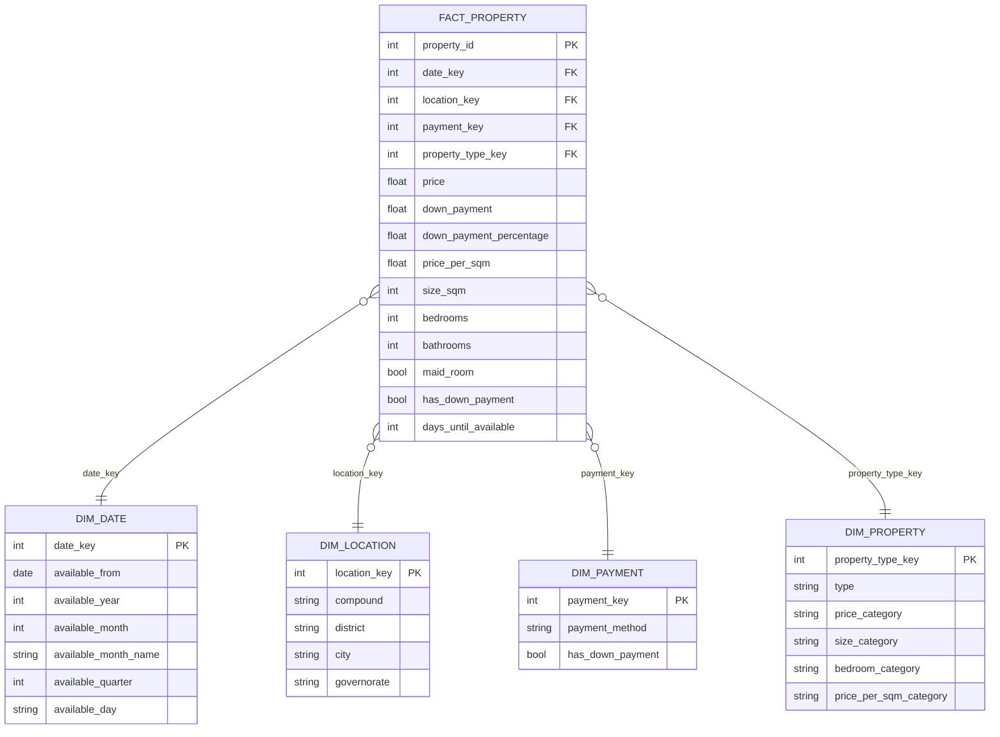

# 🏠 Egyptian Real Estate Intelligence Dashboard

**End-to-end data analytics project: from 19,924 raw property listings to an interactive Power BI dashboard, built on a Bronze → Silver → Gold (medallion) pipeline and a star-schema data model.**


---

## 📌 Project Overview

The Egyptian property market is large, fragmented, and hard to compare: prices are listed in mixed formats, sizes come in two units, locations are packed into a single text field, and many listings contain impossible values.

This project turns raw online listings into a clean, analysis-ready data model and a decision-support dashboard that answers questions such as:

- Which governorates and cities are the most expensive, per listing and per m²?
- How do prices differ across property types (apartment, villa, chalet, palace, …)?
- How much of the market is cash vs. installments, and what down payments are typical?
- Where is supply concentrated, and which price segments dominate?

## 🔑 Key Numbers

| Metric | Value |
|---|---|
| Raw listings ingested | **19,924** |
| Listings after cleaning & outlier removal | **18,871** |
| Average property price | **15M EGP** |
| Average price per m² | **73.1K EGP** |
| Average property size | **201 m²** |
| Cash vs. installments | **~80% / ~20%** |
| Property types covered | **17** |

## 💡 Insights from the Dashboard

- **North Coast is the most expensive governorate**: highest average listing price (~19.7M EGP) and highest average price per m² (~101K EGP), followed closely by the Red Sea (~98K EGP/m²).
- **Cairo has the deepest supply** with about 7.3K listings, followed by North Coast (~5K) and Giza (~4K).
- **Palaces dominate the top of the market** (avg ~142M EGP), followed by villas, whole buildings, and land.
- **The market is cash-driven**: roughly 4 in 5 listings are cash, about 1 in 5 offer installments.
- **Price per m² and total price tell different stories**: smaller premium types (e.g. cabins, hotel apartments) rank much higher per m² than their total price suggests.

> Figures are taken from the final dashboard and reflect the cleaned dataset (18,871 listings).

---

## 🏗️ Architecture: Medallion Pipeline

```
Raw CSV (PropertyFinder Egypt listings)
        │
        ▼
 🥉 BRONZE  ──  ingest as-is, profile, persist          (Bronze_layer.ipynb)
        │
        ▼
 🥈 SILVER  ──  clean, parse, standardize, validate     (Silver_Layer.ipynb)
        │
        ▼
 🥇 GOLD    ──  enrich, segment, model (star schema)    (Gold_Layer.ipynb)
        │
        ▼
 📊 Power BI  ──  3-page interactive dashboard
```

### 🥉 Bronze: Raw Ingestion
- Loads the raw listings export (11 columns, all text) and preserves it unchanged for reproducibility.
- Profiles the data: null counts, cardinality, most frequent values.
- Persists a single `Bronze.csv`.

### 🥈 Silver: Cleaning & Standardization
| Column | Problem | Solution |
|---|---|---|
| `url` | Whitespace, `http` links, duplicates | Stripped, forced to `https`, de-duplicated |
| `price` | Text with thousands separators | Converted to integer; reviewed min / max / percentiles |
| `description` | Line breaks and irregular spacing | Normalized whitespace |
| `location` | Four hierarchy levels in one string with several patterns | Custom parser → `compound`, `district`, `city`, `governorate` |
| `type` | Inconsistent casing (e.g. `iVilla`), nulls | Standardized, categorical dtype, `Unknown` for missing |
| `size` | `"1,507 sqft / 140 sqm"` text | Extracted `size_sqft` and `size_sqm` with regex; removed impossible sizes (< 20 m²) |
| `bedrooms` | Values like `3+ Maid`, `studio` | Split into numeric `bedrooms` (studio = 0) and boolean `maid_room` |
| `bathrooms` | Values like `7+`, `none`, `3.0` | Numeric `bathrooms` plus `bathrooms_plus` flag |
| `available_from` | Text dates | Parsed to `datetime`; checked range and future-dated listings |
| `payment_method` | Nulls | Categorical (`Cash` / `Installments` / `Unknown`) |
| `down_payment` | `"100,000 EGP"` text | Converted to numeric |

### 🥇 Gold: Feature Engineering & Data Model
- **Outlier handling:** kept sizes between 20 and 1,000 m², then trimmed the 1st and 99th percentile of price per m².
- **Down-payment normalization:** values entered as percentages (1–100) were converted into EGP amounts, then `down_payment_percentage` was derived.
- **Derived features:**
  - `price_per_sqm`, `price_per_bedroom`, `sqm_per_bedroom`
  - `price_category` (Budget / Mid-range / Premium / Luxury)
  - `size_category` (Small / Medium / Large / Luxury)
  - `bedroom_category` (Small / Family / Large / Luxury)
  - `price_per_sqm_category` (Very Affordable → Ultra Luxury)
  - `availability_status` and `days_until_available`
  - Date parts: year, month, month name, quarter, weekday
- **Integrity checks:** surrogate-key uniqueness validated on every dimension; null audit on the fact table.

---

## ⭐ Data Model (Star Schema)



---

## 📊 Dashboard Pages

### 1. Market Overview
KPI cards, average price by property type and price category, top 10 cities by average price, payment-method split, and average price per m² by governorate.


### 2. Property & Location Analysis
Average price by governorate, price / size / price-per-m² by property type, and property distribution across governorates.


### 3. Details
Drill-through table with governorate, city, compound, district, payment method, year, bedrooms, bathrooms, price, price per m², maid room, and down payment.


**Interactivity:** slicers for Governorate, Property Type, Payment Method, and Price Category, plus a one-click reset.

---

## 🛠️ Tech Stack

| Area | Tools |
|---|---|
| Language | Python 3.13 |
| Data wrangling | pandas, NumPy |
| Exploration | Jupyter Notebook, Matplotlib |
| Modeling | Star schema (1 fact + 4 dimensions) |
| Visualization | Power BI |

## 🧠 Skills Demonstrated

- Data cleaning on messy, real-world text data (regex parsing, type conversion, null handling)
- Outlier detection and justification (percentile analysis, domain rules)
- Feature engineering and business-friendly segmentation
- Dimensional modeling (surrogate keys, fact / dimension design)
- Medallion architecture for reproducible, layered pipelines
- Dashboard design and data storytelling for non-technical stakeholders

---

## 📁 Repository Structure

```
├── Bronze_layer.ipynb        # Raw ingestion & profiling
├── Silver_Layer.ipynb        # Cleaning & standardization
├── Gold_Layer.ipynb          # Feature engineering & star schema
├── images/                   # Dashboard screenshots
├── data/
│   └── raw/                  # Bronze / Silver / fact & dimension CSVs (not committed)
└── README.md
```

## 🚀 Possible Next Steps

- Add a time-on-market or listing-date field to analyze price trends over time
- Compare listing prices with official or historical benchmarks
- Build a price-prediction model from the engineered features
- Automate the pipeline with a scheduler and parameterized paths

---

## 👤 Author

**Eslam jabr**  
Computer Science student · Data Analyst  
📫 [LinkedIn](https://www.linkedin.com/in/eslamjabr/) · [GitHub](https://github.com/eslamjabr) · Eslamjabr55@gmail.com

⭐ If you found this project useful, consider giving it a star!
